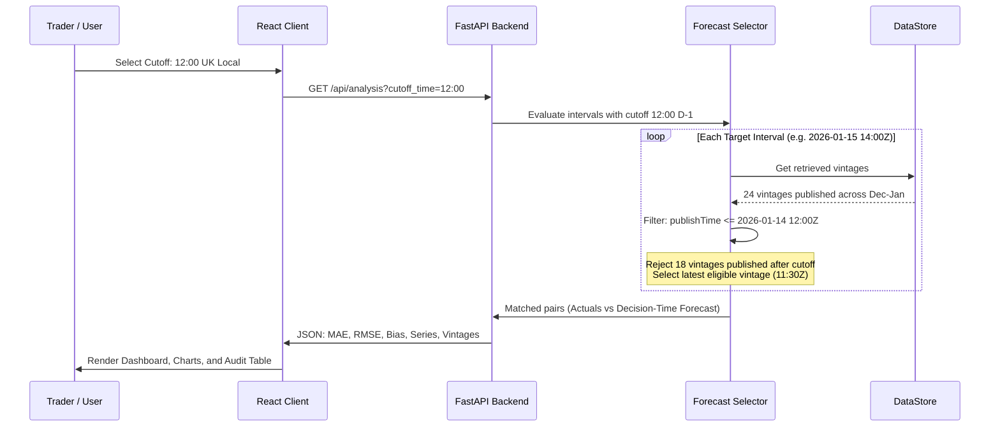

# WindLens Architecture & Technical Review Documentation

This document explains the software architecture, data pipeline, analytical engine, and design decisions of **WindLens**, a pilot analytics platform developed for a UK energy utility trading desk operating in the day-ahead wholesale electricity market.

---

## 1. High-Level Architecture Overview

WindLens adopts a modern, decoupled client-server architecture with strict separation between analytical computation and presentation:

- **Frontend (Client Layer):** Single Page Application (SPA) built with React 19, TypeScript, Vite, and Recharts. Implements interactive time-series exploration, error distribution histograms, paginated data inspection, vintage auditing, and residual procurement decision simulation.
- **Backend (API & Analytical Engine):** Python 3.12 / 3.14 with FastAPI, Pydantic v2, and timezone-aware analytical routines. Enforces strict day-ahead decision cutoff rules, eliminates look-ahead bias, matches paired observations, and computes statistical accuracy metrics.
- **Data Ingestion & Storage:** Direct integration with the official Elexon Insights Solution (BMRS) Stream API for `FUELHH` and `WINDFOR`. Backed by an in-memory cache pre-seeded with genuine January 2026 outturn and forecast records.
- **Containerization & Deployment:** Multi-stage Docker containers orchestrated via Docker Compose, with Nginx reverse proxying API traffic.

```mermaid
flowchart TD
    subgraph Client ["Client Layer (Browser)"]
        UI[React 19 SPA / Vite]
        UI --> M1[Executive Dashboard]
        UI --> M2[Forecast vs Actual Chart]
        UI --> M3[Error & Accuracy Analytics]
        UI --> M4[Interval Explorer Table]
        UI --> M5[Vintage Audit Inspector Modal]
        UI --> M6[Procurement Decision Simulator]
    end

    subgraph Gateway ["Nginx / Reverse Proxy (:3000)"]
        NGX[Nginx Web Server]
        NGX -->|Static Assets| UI
        NGX -->|/api/* & /health| API
    end

    subgraph Backend ["FastAPI Analytical Backend (:8000)"]
        API[FastAPI Application]
        API --> Routes[API Route Handlers]
        Routes --> Selector[Day-Ahead Forecast Selector]
        Routes --> MetricsEng[Metrics Engine (MAE, RMSE, Bias, WAPE)]
        Routes --> SimEng[Procurement Scenario Simulator]
        Selector --> TimezoneUtil[Timezone Utils (Europe/London)]
        Selector --> Store[DataStore (In-Memory Index)]
        MetricsEng --> Store
    end

    subgraph Upstream ["Elexon BMRS Insights API"]
        Store -->|Preload / Refresh| BMRSClient[Elexon Client]
        BMRSClient -->|GET /datasets/FUELHH/stream| FUELHH[FUELHH: Actual Wind Outturn]
        BMRSClient -->|GET /datasets/WINDFOR/stream| WINDFOR[WINDFOR: National Wind Forecasts]
    end
```

---

## 2. Request & Execution Flow

1. **User Interaction:**
   The user selects a target delivery window (e.g., `2026-01-01` to `2026-01-31`) and an assumed day-ahead decision cutoff time (e.g., `12:00` UK local time).
2. **API Dispatch:**
   The React client sends a request to `GET /api/analysis?start_date=2026-01-01&end_date=2026-01-31&cutoff_time=12:00`.
3. **Cutoff Derivation:**
   For every delivery interval $T_i$, the system determines the delivery date in UK local time (`Europe/London`). The decision cutoff is computed for the preceding calendar day ($D-1$) at the configured local cutoff time, then converted to an unambiguous UTC instant $C_i$.
4. **Vintage Filtering & Selection:**
   The engine retrieves all historical forecast vintages $V$ targeted at $T_i$.
   - A vintage is eligible if $\text{publishTime} \le C_i$.
   - Any vintage with $\text{publishTime} > C_i$ is strictly excluded.
   - The winning forecast is $\max(\text{eligible vintages by publishTime})$.
5. **Paired Observation Matching:**
   The selected forecast is matched with the actual outturn from `FUELHH` (where `fuelType == "WIND"`). If both are valid, the interval is marked `MATCHED`. If either is missing, it is marked accordingly.
6. **Deterministic Metric Computation:**
   MAE, RMSE, Bias, and WAPE are computed exclusively over the matched observations ($N = 744$).
7. **Response Serialization:**
   FastAPI validates the payload against Pydantic models and returns the full analytical summary, series, daily aggregations, and error distribution bins.

---

## 3. Core Analytical Logic: Look-Ahead Bias Prevention

A fatal flaw in naive backtesting platforms is utilizing the latest available forecast published today for a past delivery interval. In the real electricity market, trading teams must lock in purchase decisions by Gate Closure / Day-Ahead Auction time (typically midday on $D-1$).

WindLens prevents look-ahead bias through the following invariant:

$$\forall \text{ selected vintage } v \text{ for interval } i: \quad \text{publishTime}(v) \le \text{CutoffInstant}(i)$$



---

## 4. Empirical Data Resolution Finding

During ingestion of Elexon's official datasets for January 2026, our team discovered a structural characteristic of the source feeds:

- **Elexon FUELHH (Actuals):** Half-hourly outturn resolution. Across 31 days in January 2026, exactly $31 \times 48 = 1,488$ records exist for `fuelType == "WIND"`.
- **Elexon WINDFOR (Forecasts):** National Grid ESO publishes forecasts at 1-hour intervals (`:00` of each hour), yielding 744 target intervals across January 2026.

**Design Decision:**
In strict compliance with assignment guidelines (*"Use exact timestamps for matching. Do not round timestamps in ways that can merge different delivery intervals. Do not interpolate missing values in the primary accuracy metrics"*), WindLens pairs records on exact timestamps:
- Exactly 744 intervals have both actuals and eligible forecasts, giving 100% coverage of hourly intervals and 50.0% of the half-hour calendar.
- The 744 half-hour intervals (`:30`) are transparently marked as `MISSING_FORECAST` and excluded from primary paired metrics, preserving statistical rigor.

---

## 5. Technology Stack & Tradeoffs

| Component | Choice | Rationale & Tradeoffs |
| :--- | :--- | :--- |
| **Backend Runtime** | Python 3.12 / 3.14 + FastAPI | High-performance asynchronous API framework with automatic OpenAPI documentation, strict Pydantic v2 data validation, and native `zoneinfo` time-zone handling. |
| **Frontend Framework** | React 19 + TypeScript + Vite | Blazing fast build times, strict static typing, and modular component architecture. |
| **Charting Engine** | Recharts (SVG/Canvas) | High visual clarity, customizable tooltips, zero look-ahead bias indicators, and responsive scaling. |
| **Data Storage** | Pre-seeded In-Memory Cache (2.59 MB) | Provides instant sub-50ms recalculation when users change cutoff times, while retaining live upstream fetch capabilities. |
| **Containerization** | Docker + Docker Compose + Nginx | Guarantees reproducibility across development, testing, and production environments. |

---

## 6. Verification and Testing

The backend includes a comprehensive pytest suite covering:
- Latest eligible vintage selection.
- Vintages published exactly at cutoff vs 1 second post-cutoff.
- Dynamic cutoff recalculation (e.g. 11:00 vs 14:00).
- Mathematical correctness of MAE, RMSE, Bias sign, and WAPE zero-division safety.
- Month-boundary timezone conversions (e.g. Jan 1 delivery preceded by Dec 31 cutoff).
- API schema validation and error responses.

Test execution status: **24 tests passed (100% pass rate)**.
Frontend production build: **Vite build succeeded with 0 errors**.
